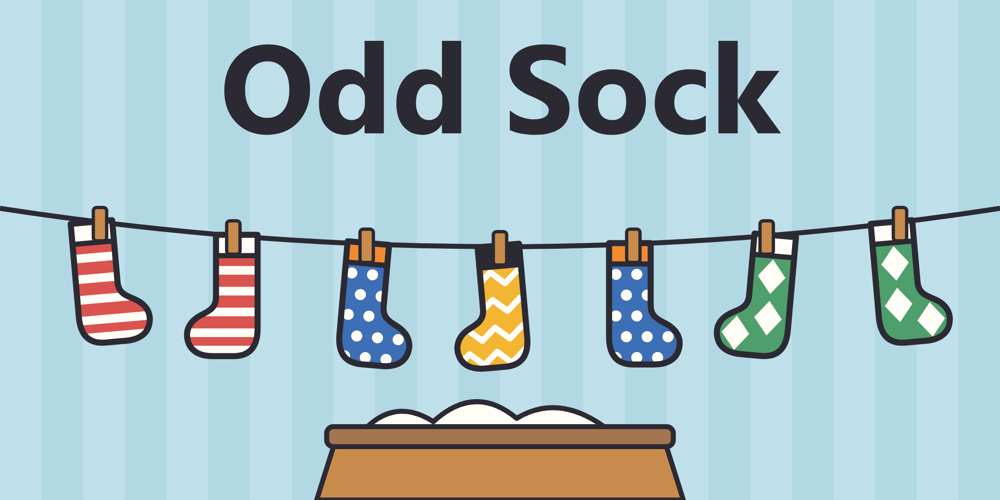

# Odd Sock

Odd Sock is a spot-the-difference game about finding the one sock with no partner, for one player or a group sharing a screen, age five and up.

## Play It

[https://jeremynyc4.github.io/game-05-odd-sock/](https://jeremynyc4.github.io/game-05-odd-sock/)

You need a phone or a computer with a web browser. One person can play alone, or a group can share one screen and take turns.

## How to Play

1. Tap Start.
2. Look at the pile of socks. Every sock has a partner except one.
3. Tap the sock that is all alone.
4. If you tap a sock that has a partner, the game sets that pair aside. Tap another sock to try again.
5. A pile counts only if your first tap is right. There are five piles, and each one is bigger than the last.
6. Tap Play Again to get five new piles.

## Play Test Log

| Round | Who played | Where they got stuck | What I changed |
| --- | --- | --- | --- |
| 1 | the AI that built it, tapping through all five piles on a phone-sized screen | Nowhere. Everything worked. | Nothing yet. |
| 2 |  |  |  |

## Made with

Built with Claude Code in Vibe Coding for Nonprofits, a Whole Whale × Meet the Moment accelerator.
